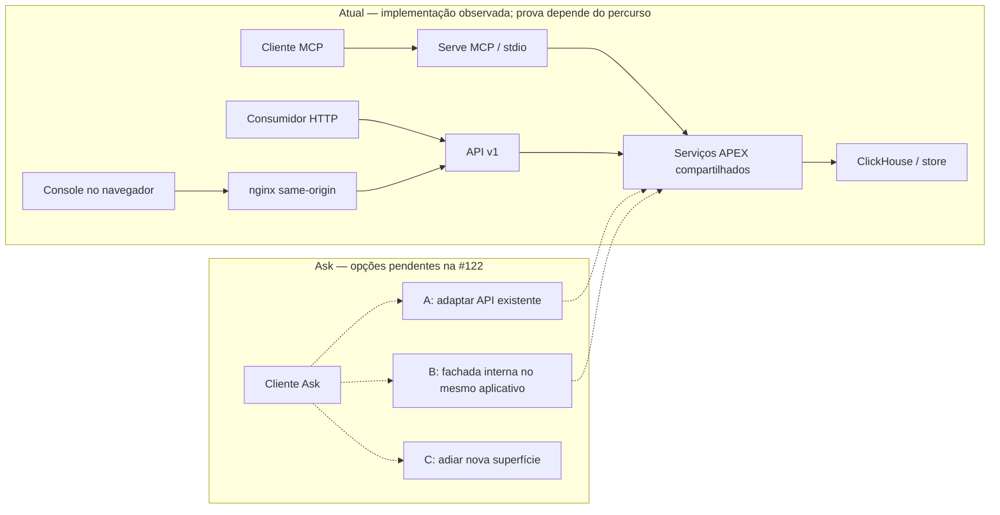

# Pod 3 — leitura inicial e decisões

O Serve já tem uma base entregue. A [#181](https://github.com/luanmorenommaciel/apex/issues/181) reúne contribuições, PRs, provas e ideias; este complemento torna a discussão acionável.

**Contribuições:** onze PRs de Augusto integradas no recorte, além de `fab6620` na #129, cuja implementação principal é de Sidymar. As cinco PRs abertas no snapshot são #157/#158/#159/#163/#164. Publicação e checks não substituem review; responsáveis e prazos precisam ser combinados.

**Evidências:** #156 registra testes locais, G1 e transporte MCP/HTTP reais com árvores e limites. #157–#159 têm CI dos heads individuais. #163 acrescenta positivo `plan_json` em processo e depende dos helpers de #157. Navegador/nginx e estados de tela têm recorte próprio na #172. Consulte a [matriz](MATRIZ-EVIDENCIAS-SERVE.md).

| Decidir / revisar | Material para discussão | Saída esperada |
|---|---|---|
| Fila de cinco PRs e pilha #157→#163 | #181 e ata | Revisor, método de integração e próxima ação |
| Backlog L1 | [23 tarefas reconciliadas](MATRIZ-L1-23.md) | Seleção pequena, status preservado até aceite |
| Ask e confiança v1 | [Alternativas #122](DECISAO-ASK-122.md), #171 | Alternativa, limites e decisão registrada |
| Privacidade e governança | [ADR-004](DECISAO-ADR-004.md), [Task-Specs](GOVERNANCA-TASK-SPECS.md) | Cinco decisões e regra proposta, ratificadas pelo time |
| Experiência HTTP e onboarding | #172 e [guia](GUIA-CLIENTES-SERVE.md) | Próxima prova delimitada e instruções por cliente |

**Próximos passos propostos:** distribuir revisões; escolher entregas L1/Ask após discutir alternativas; combinar validação do browser e encaminhar minutas aos pods. Guia e decisões são preparação documental; comandos do guia ainda não foram executados nesta etapa. Grafo #107 continua estudo ligado ao schema #106; isso não impede estudar em paralelo.

Há [destino proposto para todas as minutas](DESTINOS-MINUTAS.md) e uma [ata preenchível](ATA-POD3-MODELO.md). Sugestões, decisões pendentes e dependências técnicas permanecem identificadas. O time pode aprovar, revisar, adiar ou rejeitar propostas; ideias documentadas não viram requisitos automaticamente.

**Atualização da coordenação:** a [nova #182 do Agmar](COORDENACAO-PR-182.md) propõe Console somente API e altera arquivos também tocados por #158/#159. Combinar ordem e preservar cobertura antes de integrar; corpo e arquivos foram lidos, sem code review ou runtime novo. É proposta fora da main consultada.

## Fluxo atual e alternativas

Linha cheia indica implementação observada, **não certificação de todos os percursos**: transporte MCP/HTTP tem recibos históricos na #156; renderização no navegador e imagem/proxy aguardam o recorte #172. Linha tracejada indica proposta. A fachada não implica outro deployment. Em texto: MCP e HTTP reutilizam serviços; a experiência de navegador ainda precisa da sua prova; o Ask poderá adaptar a API, usar fachada interna ou ser adiado.
